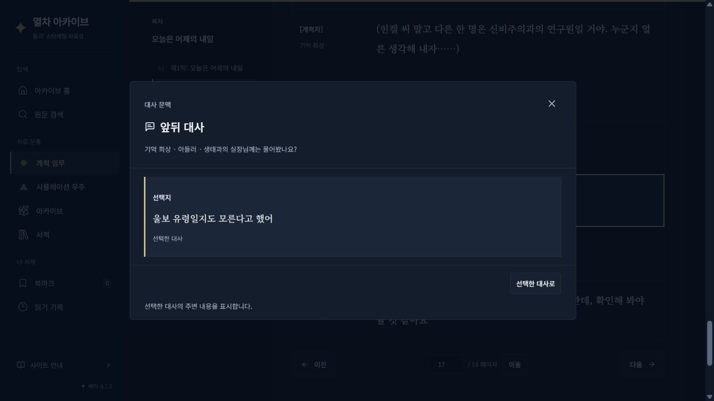
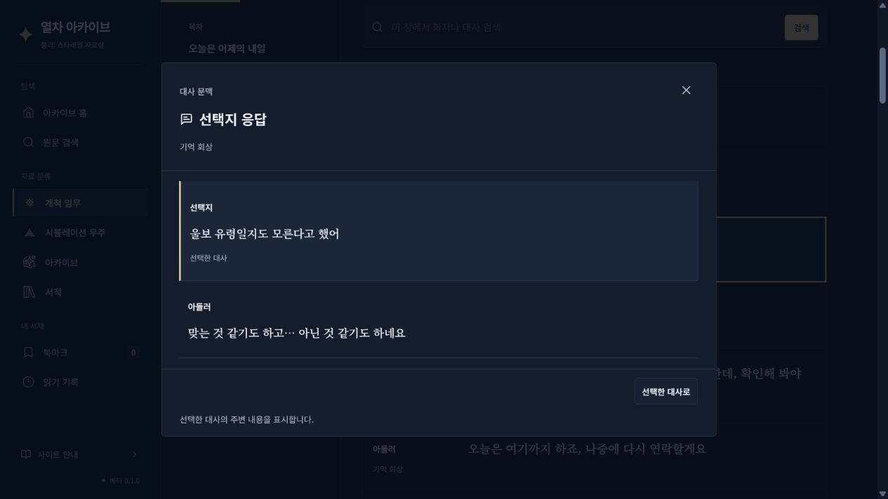
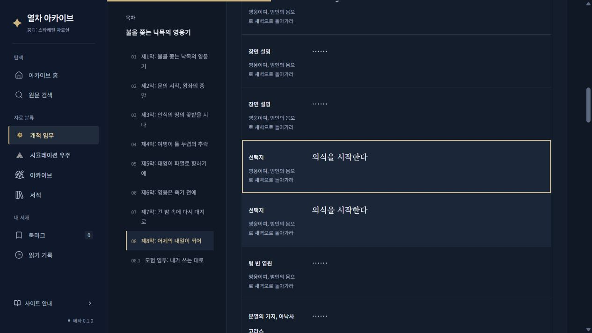

# Dimbreath 실행 데이터와 전체 개척임무 검증 개선

기존 Dimbreath 입력·공식 원문 투영·BWIKI 수집·정기 검증을 확장했다. 별도 원문 수집기나 두 번째 대사 저장소는 만들지 않았다. 대상은 등록된 개척·후문 읽기 항목 36개와 공식 Main/Gap 임무 442개다.

입력은 [DimbreathBot/TurnBasedGameData의 고정 커밋](https://github.com/DimbreathBot/TurnBasedGameData/tree/74a7b96fba32f00cf495a5c00b0311bd02207aaf)이며, 조사 당시 저장소 main과 같았다. 게임 버전은 `OSPRODWin4.6.0_D16854589_A16781679_L16781679`다. Dimbreath는 릴리스 게임 데이터의 제3자 보관소이며 HoYoverse의 공식 서비스로 표기하지 않는다. 게임 권리·Dimbreath 크레디트·BWIKI 라이선스는 유지했다. 원본 파일과 외부 Git 이력은 커밋하지 않았다.

## 결과

아래 미확인은 기존 BWIKI 위치나 검증된 실행/관측 근거도 없는 원문 행 기준이다. 전체 게임 플레이 경로의 미검증 수와 혼동하지 않는다.

| 항목 | 전체 36개 | 제8막 |
| --- | ---: | ---: |
| 기존 순서 미확인 원문 | 8,037 | 128 |
| 그중 공식 파일 내 위치를 새로 특정한 원문 | 1,199 | 9 |
| 기존 원문 중 계속 미확인 | 6,838 | 119 |
| 호출·귀속·공식 ID로 확인해 추가한 한국어 원문 | 163 | 8 |
| 새 원문 중 표시 위치까지 확인 | 156 | 7 |
| 최종 위치 미확인: 기존 미확인 + 신규 보류 | 6,845 | 120 |

36개 항목의 공식 원문 행은 61,597개에서 61,760개가 됐다. 제8막은 1,724개에서 1,732개다. 기존 원문 1,199행과 새 원문 156행, 합계 1,355행을 공식 로컬 출현으로 배치했다. 38개 출현은 같은 장면·조건의 양쪽 BWIKI 앵커와 명시적 로컬 실행 경로 사이에 배치했다. 나머지는 같은 세부 임무의 기존 슬롯에서 공식 로컬 범위로 묶었으며, 파일명이나 임무 번호로 전체 플레이 순서를 만들지 않았다.

공식 정적 출현 19,174개(고유 원문 17,668개), 로컬 실행 간선 8,960개를 기록했다. 실제 간선에 참여하는 고유 원문은 9,874개다. 기존 `flowStatus: verified` 5,621행과 새 로컬 간선 참여 행의 합집합은 10,402행이다. 이 수치는 전체 장면 시작·종료·모든 분기 또는 전체 게임 실행 순서의 검증 완료 수가 아니다. 기존 `flowStatus`와 원래 실행 간선은 덮어쓰지 않았다.

기존 공식 실행 간선에 없던 선택지→응답 쌍의 공식 근거는 572개다. 이 중 새 표시 출현에서 실제 응답 탐색에 사용할 수 있는 쌍은 83개다. 572개에는 BWIKI에서 이미 연결된 관계에 공식 근거를 추가한 경우도 포함한다. 새 사이트 응답 연결 83개와 같은 의미로 보고하지 않는다. 제8막에서 새 응답 간선은 0개다. 타임라인 본문이 없어서 선택지의 응답을 만들어 넣지 않았다.

## 확인과 보류 기준

- 공식 파일 내 위치: 같은 커밋의 명시된 대사 ID·종류, 한국어 원문과 임무 귀속을 검사한다. 반복 ID는 포인터별 출현으로 보존하고 원문 행은 공유한다.
- 공식 로컬 연결: 명시된 대화 목록 순서, 완료 대기 또는 실제 선택 신호와 유일한 대기 대상이 필요하다. 비동기 작업·조건·동시 시퀀스·미지원 작업·빠진 원문·미제공 타임라인을 건너 연결하지 않는다.
- 새 원문 수록: MissionInfo의 도달 가능한 세부 임무에서 `MissionJsonPath`와 Performance 표의 ID→파일 경로, 대상 실행 타입까지 확인한다. 같은 커밋의 중국어·한국어 및 역할을 대조하고 임무나 역할이 여러 개로 갈리면 확정하지 않는다. 짧은 선택지도 문자열 유사도가 아니라 공식 실행 참조로 특정한다.
- 잠정 관계·귀속 이견·미수록 후보·조건·반복·미지원 경계는 격리 `execution-results`에 따로 기록한다. 새로운 의미 번역이나 사용자 TXT를 원문 연결 근거로 사용하지 않았다.

잠정 기록은 위치·관계·미수록 후보가 섞인 항목 수이며, 고유 대사 행 수로 세지 않는다. 전체 알고리즘 정확도의 정답 비율을 측정한 것으로 주장하지 않는다.

## 순서 이견

같은 로컬 파일의 관계와 BWIKI에서 반대 방향으로 보이는 후보는 3개다. 페나코니 `our-time`의 `Act103290105.json` 1개, 앰포리어스 `journey`의 `Act104010521.json` 2개다. 해당 연결 성분의 새 표시 반영은 보류했고 기존 BWIKI 위치·검증 연결은 유지했다. 임무 호출 인스턴스까지 같은 경로라는 근거가 부족하므로 실제 충돌로 확정하지 않았다.

제8막 A→B / A→X→B는 계속 실행 범위 미확인이다. 이번 제8막에서 비교 가능한 공식 로컬 관계 27개는 BWIKI와 양립했다. 다른 Act·Discussion·Timeline을 한 실행으로 합치지 않았다. 공식 파일의 많은 `PlayTimeline` 참조는 타임라인 본문이 저장소에 없어 경계로 남는다.

## 자동화와 복구

같은 커밋의 구조 JSON 10,298개와 Performance A/C/D/DS/CG/E 및 `PerformanceSubMissionLink` 표를 기존 내용 기반 캐시로 검증했다. MissionInfo의 선행 임무 관계는 대사 간선과 별도 보존했다. 표·호출 파일·조건의 입력 해시, 검증 코드와 정책 버전 3을 기록한다. 큰 정수 조건 해시는 문자열로 보존한다.

`source-first.mjs`는 BWIKI 대조 후 조회 대기 문서의 이전 고정 위치를 보존하고, **복구된 최종 BWIKI 계층을 기준으로** 공식 실행 투영을 수행한다. 전체 갱신·재시도·격리 CLI가 이 순서를 공유한다. 변경된 공식 커밋과 실행 검증 코드/정책은 기존 6시간 예약 변경 감지에서 재검증 대상으로 처리한다. 임무별 승인 없이 전체 등록 임무를 순회하고, 어려운 범위는 잠정 기록으로 남긴 채 다음 임무를 처리한다.

회귀 재현에서 조회 대기 복구를 생략한 후보의 위치 4,301개·표시 간선 3,462개 손실을 보존 검사가 차단했다. 공통 복구 후 남은 위치 30개·간선 27개 차이는 문서 하나의 오래된 재현 수정본 때문이었다. 현재 배포본의 수정 번호 `104577`과 SHA-256을 검증해 입력을 맞췄다. 손실 검사를 낮추거나 확보한 문서의 회귀를 조회 실패로 위장하지 않았다. 최종 자동 경로 재현에서는 위치·간선·원문 손실 모두 0개다.

운영 데이터는 최종 계약과 공통 보존 검사·복구 검사를 통과한 후보만 반영한다. 검증기를 포함한 공통 오류나 기존 근거 손실이 있으면 게시를 중단하고 마지막 성공 스냅샷을 유지한다. 같은 빌드 산출물만 배포하며 검증 후 재수집하지 않는다.

## 회귀 검증

- 기존 한국어 행 61,597개의 모든 필드와 상대 배열 순서, 기존 BWIKI 출현 전체가 정확히 유지됐다.
- 기존 전체 검색 행과 해당 항목의 영어·중국어·일본어 투영이 정확히 유지됐다. 새 163행도 동일 공식 ID로 연결했다. 기존 공식 입력에 원문이 없는 324개 자리표시는 보존했다.
- 기존 검증기가 처리하던 실제 1,802개 파일의 간선 6,849개와 새 부분 검증 결과를 비교해 반대 연결은 0개였다.
- 최종 콘텐츠 계약: 2,840개 본문·67,651행 통과. 전체 36개·442개 임무의 정기 경로 재현과 저장소 호환성 검사 통과.
- Node 회귀 검사 115개 통과. 그 안에 새 실행 모듈의 Python 20개 사례 검사가 포함되므로 두 수를 합산하지 않는다.
- 기존 행 ID·챕터 주소·북마크 키와 선택지 기능을 유지했다. 일반 목록에 검증 상태나 중국어 장면 제목을 다시 노출하지 않았다.

기계 판독 집계·장별 결과·새 원문 ID는 [JSON](dimbreath-execution-2026-10-22.json), 전체 잠정 기록과 실행 증거는 `.cache/execution-improvement/automation-replay/execution-results`에 보존했다. 재현·보존 비교는 `.cache/execution-improvement/final-comparison.json`에 있다. 사용자 TXT를 입력으로 사용하지 않았다.

## 배포 및 화면 확인

구현·운영 데이터 커밋 `63f1c59a`의 [배포 실행](https://github.com/moleculargastronomy1/hsrArchive/actions/runs/39733198202)이 성공했다. 테스트·최종 계약·빌드 산출물 동일성 검사 후 같은 산출물을 게시했다. 실제 사이트의 `site-update.json`에서도 해당 커밋을 확인했다.

실제 게시 사이트에서 `울보 유령일지도 모른다고 했어` 선택지에 아들러의 `맞는 것 같기도 하고… 아닌 것 같기도 하네요` 응답이 표시되는 것을 확인했다. 변경 전에는 같은 선택지의 문맥창에 응답이 없었다. 일반 목록의 표시 형식은 화자·임무·대사이며 기술 검증 상태는 노출하지 않는다.

| 변경 전 | 변경 후 |
| --- | --- |
|  |  |

정기 실행의 `execution-results`, `execution-report.json`, `execution-progress.json`도 기존 체크포인트 캐시와 90일 실행 증거 아티팩트에 보존한다. 이전 기록을 복원하더라도 입력·코드·정책 검사를 생략하거나 잠정 항목을 자동 확정하는 근거로 쓰지 않는다.

제8막 실제 게시 화면에서도 `의식을 시작한다` 선택지의 공식 출현 링크가 열리고, 근거 없는 응답을 추가하지 않는 것을 확인했다. 같은 문장의 다른 공식 행은 합치지 않았다. 화면의 1,732줄은 고유 원문, 읽기 목록의 1,777줄은 반복 출현을 포함한 표시 행 수다.

별도로 자동 실행된 [정기 재대조 후보](https://github.com/moleculargastronomy1/hsrArchive/actions/runs/39737002851)는 기존 검증 손실 1건, 연결 변경 7건, 순서 변경 10건, 읽기 위치 손실 63건, 읽기 연결 손실 9건을 공통 보존 검사가 발견해 게시를 차단했다. 이 수들은 서로 겹칠 수 있다. 해당 후보는 이번 정상 배포와 구별하며, 후보가 실패한 뒤에도 마지막 성공 데이터가 유지되는 것을 실제 사이트에서 확인했다. 이 후보의 회귀 원인별 확정·해소는 이번 결과로 주장하지 않는다. 현재 격리 검증 결과와 원문 개선 수치도 변경하지 않았다.

격리 증거 보존 설정을 포함한 최종 운영 커밋은 `12fba3bd`이며, [후속 배포](https://github.com/moleculargastronomy1/hsrArchive/actions/runs/39751960661)도 성공했다. 본문 데이터는 첫 배포에서 검증한 것과 같고 후속 실행에서도 최종 계약·테스트·산출물 동일성 검사를 통과했다.
