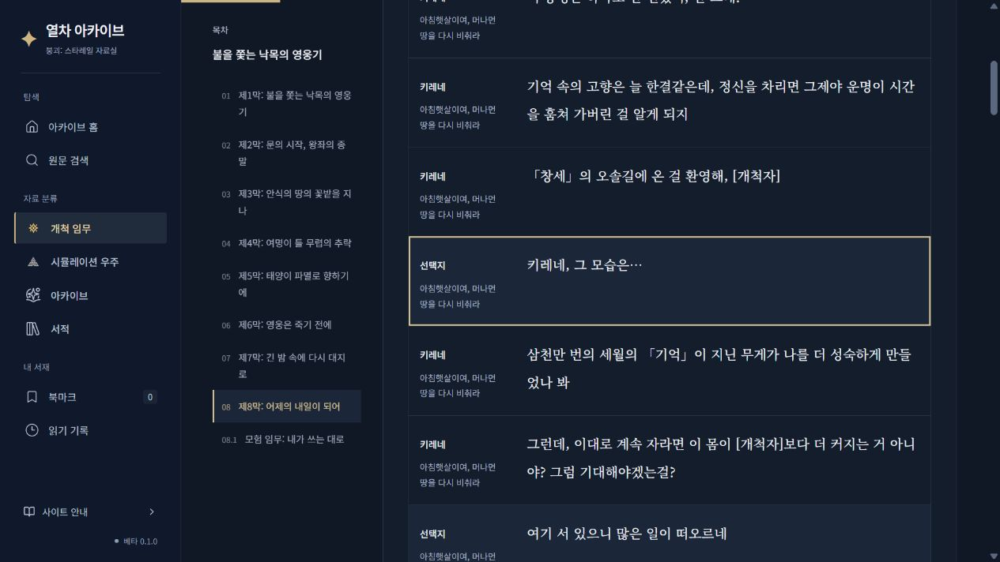
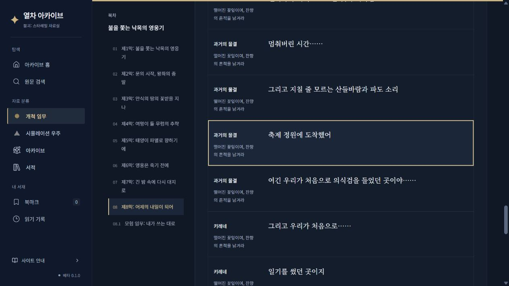

# 대사 화면 정리와 BWIKI 출현별 대조 TXT

기존 복원 산출물 `5a84e4b91ea857e93b19b0c89b9ab43f080054a0`에서 이어서 처리했다. 원문 연결과 전체 감사를 불필요하게 다시 계산하지 않고 완료된 격리 체크포인트와 실제 사이트 렌더러의 출현 배열을 사용했다. 기존 복원 수치는 [복원 보고서](wiki-placement-2026-10-21.md)를 따른다.

## 화면

일반 목록에는 화자·임무명·대사를 표시한다. 중국어 장면·조건 제목, BWIKI/공식 실행 검증 문구, 구간 상태 제목, 기술 안내문을 제거했다. 검증 근거와 원문 ID·출현 ID·분기 정보는 내부 데이터에 유지했다. 명시된 선택지 응답, 응답에서 선택지로 돌아가기, 기존 별도 연결의 `다른 대화 보기`는 대화창에 보존했다. 북마크와 기존 원문 주소는 바꾸지 않았다.

실제 미리보기에서 기술 문구가 표시되지 않는 것, `키레네, 그 모습은…`의 응답과 `「부세」의 절망을 짊어진다`의 별도 대화가 열리는 것을 확인했다.

## TXT 제공 범위

출력 폴더는 `.cache/wiki-placement/exports`다. 원문을 포함하는 파일은 Git에 올리지 않았다.

- `전체36개_BWIKI_1대1_대조.zip`: 36개 항목별 TXT, 안내문, 버전·집계 manifest.
- `제8막_어제의_내일이_되어_BWIKI_1대1_대조.txt`: 제8막 별도 파일.
- 각 TXT의 A는 BWIKI 문서 표시 순서, B는 사이트 표시 순서다. C에는 장면 경계·미지원 구조를, D에는 고정 수정본과 보류 사유를 기록했다.
- 중국어 표시 본문·화자, 공식 한국어 원본과 사이트 한국어, 공식 ID, 두 순번·페이지·일치 여부, 반복·조건·선택지 가지·응답 출현 ID를 포함한다.

전체 BWIKI 대사·선택지 출현 **71,039개**, 사이트 표시 **61,406개**를 각각 빠짐없이 기록했다. 확정된 **46,154개 출현**은 A/B에서 출현 ID와 원문 ID가 양방향 1:1로 동일함을 검사했다. BWIKI의 연결 미확정 출현은 24,885개다. 사이트의 기존 검증 보존 구간·미확인 원문·소개문은 별도로 구분했다. 공식 입력에 대사 원문이 없는 기존 자리표시 324행도 누락으로 따로 기록했다.

제8막은 BWIKI 출현 3,276개, 사이트 표시 1,769개다. 확정 출현 1,597개 중 1,586개는 중국어 표시 본문이 일치하고 11개는 이전에 검토한 고정 번역 근거에 따른 대응이다. 11개를 문장 자체의 동일 일치로 세지 않았다. BWIKI 연결 미확정 1,679개와 사이트의 기존 구간 보존 44행·순서 미확인 128행을 구분했다.

한국어 원본의 특수 공백·서식·이름 토큰은 기존 공식 표시 변환을 적용해 검사했다. 비교 파일에는 원본 문자열도 별도 보존한다. 새로운 번역 의미 대응이나 유사 문장 연결은 하지 않았다. 순번은 두 배열에서 독립적이므로 누락·보류 행이 있으면 같은 숫자일 필요는 없다. ZIP 무결성과 36개 TXT의 열·순번·출현 ID 유일성·확정 연결 왕복 일치를 검사했고 불일치는 0건이다. 파일은 해당 고정 수정본의 비교 결과이며 실시간 BWIKI 연동 파일이 아니다.

## 예약 갱신 보존 수정

[예약 경로 시험 39590077514](https://github.com/moleculargastronomy1/hsrArchive/actions/runs/39590077514)에서 문서 5개가 조회 대기 상태가 되자 출현 정보가 줄어드는 후보를 발견했다. 손실 검사가 출현 커버리지 956건·표시 간선 711건의 손실을 감지해 게시를 차단했다. 당시 정상 게시된 복원 결과는 바뀌지 않았다.

`wiki-reading-recovery.mjs`는 수집 결과에 명시적으로 조회 대기·실패로 기록된 문서만 같은 공식 커밋의 이전 고정 출현으로 보존한다. 기존 원문이 달라지면 중단한다. 이전 코드·정책·입력·문서 수정본을 별도로 남기며 현재 문서를 새로 검증한 것으로 처리하지 않는다. 확보한 문서에서의 위치·간선 손실은 여전히 자동 반영을 차단한다.

실패한 것과 같은 5개 문서의 부재를 기존 산출물에서 재현한 결과, 수정 전 956건·711건의 손실이 동일하게 재현됐고 보존 처리 후 두 손실 모두 0건이었다. 이 재현은 데이터 복원이나 원문 연결을 다시 수행하지 않았다. 회귀 검사 112개, TypeScript, 최종 콘텐츠 계약과 동일 빌드 산출물 검사도 통과했다.

## 배포 확인 상태 (2026-10-22 한국 시간)

수정 커밋은 `e8242fc8e258c50f5749f37cc55699563931ae1f`다. [수정본 실행 39623105890](https://github.com/moleculargastronomy1/hsrArchive/actions/runs/39623105890)의 build는 성공했다. CI에서 112개 검사와 동일 산출물 검사를 통과했고, 배포 단계는 GitHub 실행 서버 배정을 기다리고 있다. [예약 경로 재시험 39623742548](https://github.com/moleculargastronomy1/hsrArchive/actions/runs/39623742548)은 앞선 실행 뒤에 대기 중이다. 두 실행을 성공 완료로 처리하지 않았다.

GitHub 공식 상태 API는 2026-10-22 00:15 한국 시간에 갱신된 Actions `degraded_performance`를 보고했다. 배포 job의 runner_name은 null이고 실행 step은 아직 없으며, 환경 승인 대기는 없다. [공식 상태](https://www.githubstatus.com/)를 함께 확인했다. 코드 오류가 확인되지 않은 대기 상태 때문에 재수정하거나 정상 실행을 취소하지 않았다.

현재 사이트는 `5a84e4b9`를 표시한다. 이후 예약 실행 `39603320035`가 동일 코드의 검증된 추가 연결을 반영했으므로, 제공 TXT의 고정 비교본과 최신 사이트 전체 집계가 같다고 주장하지 않는다. 36개 실제 본문과 최초 기준본의 비교에서 기존 한국어·ID·기존 연결 손실은 없고 연결 추가가 확인됐다. 제8막의 출현 계층 수치(1,597개)와 원문 행 수(1,724개)는 제공 비교본과 같다. 전체 최신 사이트에는 공식 원문 행 61,597개와 출현 50,486개가 있다. 이 결과는 `.cache/wiki-placement/current-live-differences.json`에 보존했다.

기술 안내문·중국어 장면 제목 제거의 실제 배포 화면 확인은 아직 남아 있다. 로컬 미리보기 확인과 실제 배포 확인을 구분한다. 진행 상태와 두 Actions 실행 ID는 `.cache/wiki-placement/progress.json`에 저장했다.

## 새 실행 배포 완료 (2026-10-22 00:29 한국 시간)

사용자 요청에 따라 종료 처리 지연에 걸린 이전 실행과 새 실행의 대기열을 분리했다. 이전 실행의 build는 성공, deploy job은 취소 완료이며 실제 실행 중인 job은 없었다. 기존 동시 실행 그룹만 `github-pages-v2`로 변경했고 `cancel-in-progress: false`, 모든 검증·복구 단계·권한·산출물 봉인·같은 산출물 게시 조건은 유지했다. 변경 범위가 그룹명과 설명 주석뿐임을 검사했다.

[새 실행 39625833264](https://github.com/moleculargastronomy1/hsrArchive/actions/runs/39625833264)는 커밋 `3c46b2af1235ddb70a0fa918181d39c4ab8ae60e`에서 build·deploy 모두 성공했다. 112개 검사 통과, 실패 0개이며 검증한 데이터와 빌드 산출물이 같다는 계약을 통과했다. 새 수집이나 전체 복원을 반복하지 않고 마지막 정상 게시 데이터에서 사이트 수정만 빌드했다.

실제 사이트의 `site-update.json`에서 해당 커밋을 확인했다. 사용자가 지적한 `用仪式剑锚定最初的因果` 장면의 실제 제8막 33페이지에서 기술 안내문, 중국어 장면 제목, `기존 검증 구간`·`기존 검증 연결`·`BWIKI 순서 확인`·`공식 실행 순서 미확인`이 표시되지 않는 것을 확인했다. 화자·한국어 임무명·대사만 표시했다. 같은 페이지의 선택지를 열어 미미의 응답과 선택한 원문으로 돌아가는 주소도 확인했다.

36개 실제 본문을 다시 비교했으며 기존 한국어·ID·연결 손실은 0건이다. 앞서 예약 갱신이 추가한 연결은 보존됐다. 예약 경로 재시험 `39623742548`은 이번 게시를 먼저 처리하기 위해 실행 전 취소했으므로 그 실행을 성공으로 보고하지 않는다. 문서 5개 부재 재현 검사 통과와 실제 예약 전체 경로 완료를 구분한다.
