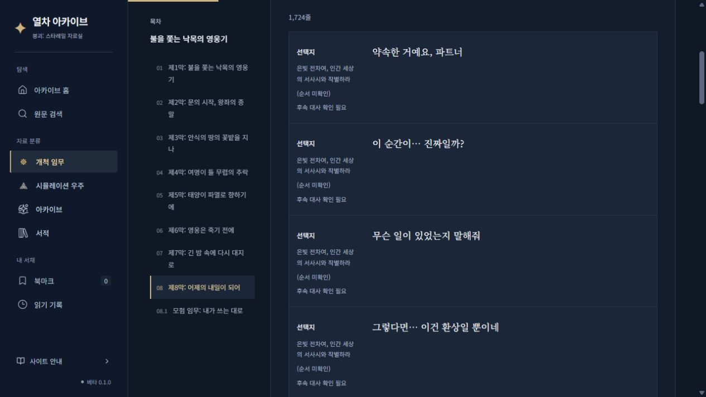
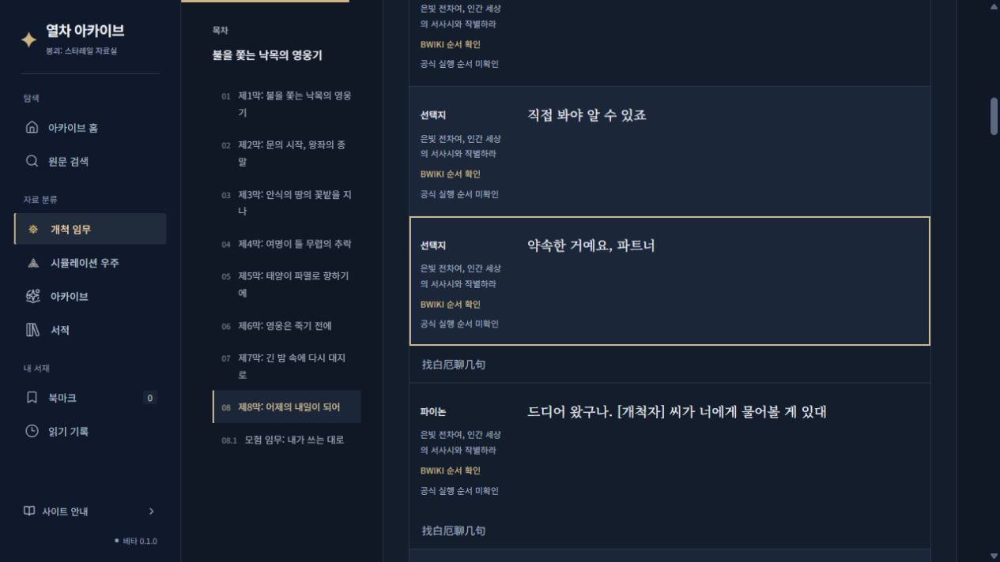
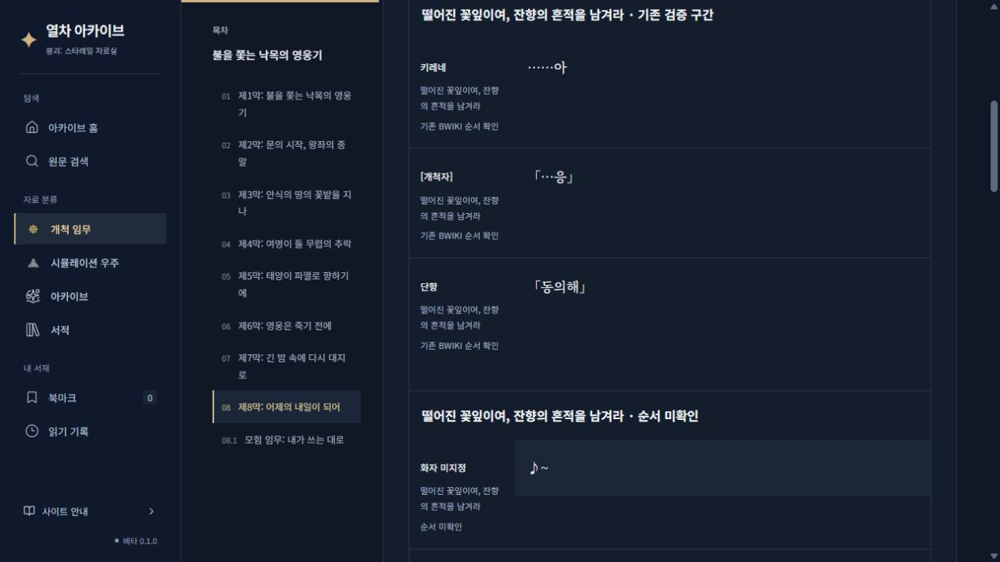
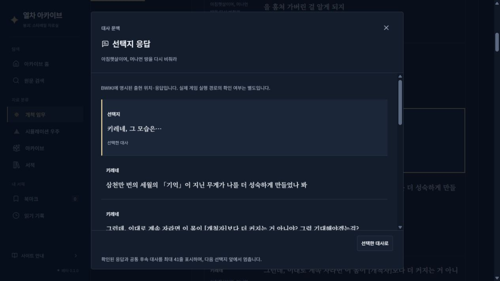
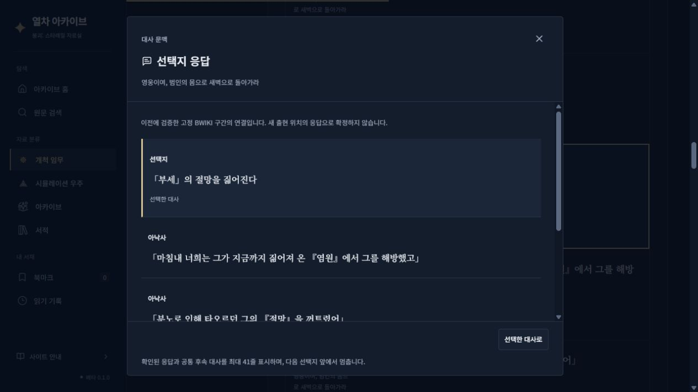

# 전체 개척 임무 BWIKI 출현 위치 복원

2026-10-21. 배포 중이던 마지막 성공 스냅샷과 동일한 공식 입력·BWIKI 수정본으로 비교했다. 원문 배열을 재배열하지 않고 별도 출현 계층으로 읽기 화면을 구성한다. 미확인 영역의 화면 표기는 사용자 요청에 따라 **순서 미확인**이다.

| 항목 | 제8막 「어제의 내일이 되어」 | 전체 36개 읽기 항목 |
| --- | ---: | ---: |
| 기존 순서 미확인 원문 행 | 332 | 16,116 |
| 이 중 BWIKI 장면에 새로 배치 | 204 | 4,609 |
| 명시된 선택지 응답을 새로 연결한 공식 행 ID 쌍 | 34 | 1,320 |
| 기존 미확인 중 여전히 순서 미확인 | 128 | 11,507 |
| 공식 실행 순서 검증 행 | 7 → 7 | 5,621 → 5,621 |
| 구조화한 BWIKI 출현 수 | 1,597 | 46,154 |
| 동일 원문을 공유하는 추가 출현 수 | 45 | 147 |

전체 읽기 항목은 개척 임무·후문 및 기존 연결 모험 임무를 포함한다. 공식 Main/Gap 임무 442개를 조사했다. 해당 항목 원문은 61,259행이며 전체 사이트 원문은 67,150행이다. BWIKI 요청 문서 284개 중 고정 수정본 255개를 재사용해 격리 검증했고, 29개의 조회 불가·미확보 기록은 그대로 남겼다. 최신 문서의 실시간 전수 조회를 뜻하지 않는다.

새 출현 계층에서 위치를 복원하지 못한 원문은 15,252행이다. 여기에는 **이미 다른 근거로 검증된 3,744행**과 챕터 소개문 1행이 포함된다. 기존 BWIKI 검증 행 중 새 세부 구조로 아직 복원하지 못한 2,104행도 이 범위에 포함되며, 검증 취소 없이 원래 세부 임무의 `기존 검증 구간`에서 원래 연결로 읽는다. 이 수치를 새로 미확인이 된 행이나 연결 손상으로 집계하지 않는다. 실제 남은 순서 미확인 대사는 11,507행이다.

## 기존 규칙과의 정확도 비교

정답 대조 자료가 전체 분기를 포괄하지 않으므로 실제 오연결률·정확도 백분율은 산출하지 않았다. 자동 연결 기준을 느슨하게 바꾸지 않았다. 동일 입력 비교에서 36개 항목의 공식 원문 행 배열·공식 ID·사이트 ID·한국어 원문·화자·귀속·기존 간선이 모두 같았다. 기존 검증·실행·영상 근거, 콘텐츠 주소 및 이미지 손실 검사는 모두 0건이다.

제8막 기존 BWIKI 검증 원문 1,390행 중 1,346행은 새 출현 계층에 배치했고 44행은 기존 검증 구간에서 보존했다. 기존 BWIKI 간선 1,080개 중 1,022개는 새 출현 연결에도 나타난다. 원래 검증 간선 1,080개는 전부 그대로 보존했다. 새 구조로 재확정하지 않은 연결은 `기존 검증 구간`이나 `기존 검증 연결`에서 별도로 조회한다. 빈 응답과 공통 후속 대사를 구분해 별도 조회로 보존한 선택지 연결 3개도 여기에 포함된다.

초기 격리 시제품에서 선택지의 비어 있는 본문을 공통 후속 대사로 연결한 후보가 발견됐다. 이 후보들은 공개 반영 전에 제외했다. 선택지 응답 증가는 해당 가지 안에 직접 응답이 명시된 34쌍만 집계한다. 기존 미확인 중 새 배치 수도 공식 테이블의 미수록 중복 후보를 검사하면서 초기 209행에서 204행으로 줄였다. 기존 문서 단위 연결 역시 새 출현의 ID 유일성 예외로 쓰지 않도록 보완했다. 제8막에서 해당 예외에 의존하던 46개 출현은 재확정하지 않았고, 그중 44개 원문은 기존 검증 구간으로 남겼다. 전체 새 배치 수도 보완 전 4,613행에서 최종 4,609행으로 줄었다. 유일하게 특정할 수 없는 반복 문장은 보류한다. 보완 전 결과는 로컬 격리 기록으로만 남겼으며 배포하지 않았다.

BWIKI 표시 순서와 공식 실행 구조는 별개다. 새 계층은 `BWIKI 순서 확인`으로 표시하고 공식 실행 검증 상태를 올리지 않는다. A→B / A→X→B 사례는 계속 **실행 범위 미확인**이며 실제 충돌·오탐으로 확정하지 않았다. 사용자 제공 TXT는 매칭·귀속·순서 생성 입력으로 사용하지 않았다.

## 실제 화면 회귀 검증

변경 전 제8막 마지막 페이지에는 여러 세부 임무의 미확인 선택지가 섞여 있었다.

`약속한 거예요, 파트너` 선택지는 기존 마지막 페이지에서 해당 BWIKI 장면의 31페이지로 이동했다. 명시된 응답이 없으므로 응답을 추정해 연결하지 않았다.

남은 미확인 대사는 세부 임무별 `순서 미확인` 제목으로 나뉜다.

`키레네, 그 모습은…`을 눌러 해당 가지의 명시된 응답만 표시하고 다른 선택지의 응답을 섞지 않는지 확인했다.

`「부세」의 절망을 짊어진다`의 기존 고정 BWIKI 연결도 별도 조회로 유지했다.

반복 원문 `amphoreus-records-yesterdays-tomorrow-quest-1043704-590`의 두 번째 출현 주소로 이동해 원문 ID는 같고 `occ-a61614238c6629f39453adc6`만 강조되는 것을 확인했다. 로컬 화면에서 북마크 추가→서재의 기존 항목 주소→해제까지 확인하고 시험용 북마크를 원상복구했다. 기존 사용자의 저장 기록을 전수 열람하거나 실제 기기의 모든 북마크를 검사한 것은 아니다.

## 검증 및 배포 계약

- 최종 데이터 계약 검사: 2,840개 본문·67,150행 통과.
- Node 회귀 검사 109개 통과. 여기에 Python 출현 검증 4개 사례와 기존 Python 데이터 검사들이 포함된다.
- TypeScript 검사와 정적 미리보기 빌드 통과.
- 복구 기준 선택에 출현 수·원문 참조·연결 손상 검사를 추가하고 원문 행이 같아도 출현 계층의 손실을 차단했다.
- 원문 기준 커밋: `74a7b96fba32f00cf495a5c00b0311bd02207aaf`.
- 정책 버전 2. 입력·수정본·코드·정책·실행 구조·검토 기록을 포함한 재사용 키를 유지한다.
- 최종 검증한 산출물은 해시로 봉인하고 같은 산출물만 빌드·배포한다. 공통 검증 오류나 기존 근거 손실이 발생하면 반영을 중단하고 이전 성공 스냅샷을 보존한다.

배포 결과는 Actions 완료 후 이 문서에 추가한다. 장별 집계와 보존 검사 결과는 [JSON](wiki-placement-2026-10-21.json)에 기록했다.
