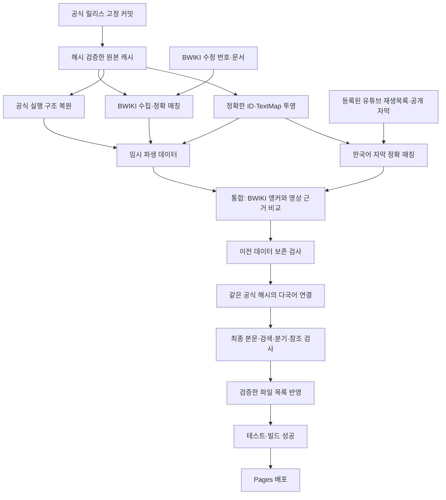

# 수집·검증·게시 모듈 구조

2026-10-22에는 기존 공식 입력 수집에 Performance 표와 MissionInfo 호출 대조를 추가했다. 새 수집기를 만들지 않고 같은 커밋·Git blob 캐시를 사용한다. `source-first.mjs`가 BWIKI 조회 대기 복구를 공통 수행한 다음 `source-first.py --execution-only`로 공식 실행 계층을 만든다. 전체 갱신·재시도·격리 CLI가 이 순서를 공유해, 복구 전의 불완전한 문서 배열을 실행 배치 근거로 삼지 않는다. `execution-placement.py`의 역할·허용 범위·잠정 기록과 원문 보존 계약은 [자료 변환](content-import.md#확인된-장면-연결-복원)에 기록했다. 원문 커밋 변경 및 공식 검증 코드·정책 변경은 기존 예약 변경 감지에 통합되며 임무별 승인을 요구하지 않는다.

2026-10-21부터 `source-first.py` / `source-first.mjs`를 전체 개척·후문 원문 우선 검증 단계로 사용한다. 기존 파서와 공식 입력 검증기를 재사용하고, 조건·접힌 대화의 출현 위치, 전역 내용 후보, 명시적 임무 귀속, 순서 비교를 분리한다. 신규 원문은 이 단계에서만 추가하며 이전 소개문 확장기의 전역 일치만으로 게시하는 경로는 기본 갱신에서 제외한다. 기존 본문 정합·시뮬레이션·독립 영상 검증은 유지한다.

기존 소개문 확장기로 이미 수록된 본문은 `import-bwiki-chapters.py --revalidate-existing`로 별도 재검증한다. 일반 대사 정합 뒤에 이 단계를 실행해 기존 내레이션·자막의 정확한 TalkSentence ID 또는 TextMap 해시·한국어·화자·종류·기존 문서 그룹을 재확인하고 고정 수정본의 기존 간선만 유지한다. 이 모드에서는 새 위키 본문을 파싱하거나 새 행·귀속·간선을 만들지 않는다. 원문·ID·기존 귀속·근거가 바뀌어 재검증에 실패하면 최종 보존 검사가 계속 게시를 막는다. 전체 및 장별 재시도는 이 공통 경로를 사용한다.

일괄 실행은 임무 문서별 체크포인트를 저장하고 장별·임무별 보고서를 만든다. 명시적 구조 참조가 없는 대사는 내용 후보이며 자동 수록하지 않는다. 제8막 A→B/A→X→B는 실행 범위 미확인이다. 신규 의미 번역을 자동 승인하지 않으며 사용자 TXT를 수집기·연결기에 입력하지 않는다. 격리 실행의 수집 대기 상태는 운영 재시도 일정과 독립적으로 보관한다.

`source-first-publication.mjs`의 해시 목록을 최종 검사·테스트 전에 생성하고 빌드 후 다시 대조한다. 공개 데이터의 원래 바이트와 빌드에 포함된 바이트가 다르면 Pages 업로드를 막는다. 배포 작업은 업로드한 동일 빌드 아티팩트만 게시한다. 공통 검증기 예외가 발생한 단계는 게시하지 않으며 마지막 배포 스냅샷을 보존한다. 세부 실행·재개 계약은 [전체 수록 조건](bwiki-full-coverage.md)을 따른다.

BWIKI 전체 문서의 누락 수록과 원문/출현 위치/분기 순서의 분리 기준은 [BWIKI 전체 수록과 순서 검증 조건](bwiki-full-coverage.md)을 따른다. 현재 적용한 구간 분리·번역 내용 대조와 후속 구현할 전체 출현 위치 그래프의 범위를 그 문서에서 구분한다.

화면·문구 등 소스 코드의 배포는 마지막 검증 배포본을 복원하여 검사·테스트·빌드한다. 이때 원문 변환·BWIKI/영상 수집·공식 영상 갱신을 실행하지 않으며, 새로 관측한 원문 커밋이나 BWIKI 수정 번호를 처리 완료로 기록하지 않는다. 예약된 자료 갱신과 미확인 대상 재시도는 별도 실행에서 기존 일정에 따라 계속한다.

2026-10-17 코드 구조 점검 및 최소 리팩터링 기준이다. 새 기능과 UI 변경 없이, 기존 단계의 책임과 게시 전 검사만 정리했다.

## 점검 결과와 변경 범위

| 영역                   | 확인 결과                                                                | 처리                                               |
| ---------------------- | ------------------------------------------------------------------------ | -------------------------------------------------- |
| 공식 입력              | 고정 커밋·Git blob 검사, Python 정수 파싱, 제외된 캐시에 원본 저장       | 유지                                               |
| 공식 대사 ID 매칭      | 중국어·한국어·화자·종류와 정확한 ID/해시로 연결, 모호한 후보 제외        | 유지                                               |
| BWIKI 수집             | 수정 번호 조회와 본문 수집 어댑터, 콘텐츠 해시 캐시, 접근 실패 대기 분리 | 유지                                               |
| BWIKI 파서·장 확장     | 장 확장이 같은 파서와 공식 매칭 규칙을 재사용                            | 유지                                               |
| 전체 갱신·재시도       | BWIKI 발견/반영 순서와 Python 실행기가 중복                              | 공통 모듈 추출                                     |
| 이전 BWIKI 근거 재사용 | 동일한 검증 조건이 별도 반복문에도 존재                                  | 기존 `cached_chunk_valid` 재사용                   |
| 영상 대조              | 수집·정확 매칭 파일 안에 BWIKI 앵커 비교와 순서 반영까지 포함            | 통합 모듈로 이동                                   |
| 자막 증거 재검사       | 행 반영과 표시용 건수 계산의 유효성 조건이 다름                          | `validatedCaptionMatches` 공유                     |
| 배포본/저장소 선택     | 같은 확인 상태만 비교해 분기·순서 충돌을 놓칠 수 있음                    | 기존 간선·확인된 상대 순서까지 보존 검사           |
| 재시도 변경 감지       | 실행 구조·영상 상태와 근거의 변경이 digest에서 빠짐                      | 통합 비교에 포함                                   |
| 파일 반영              | 두 경로의 게시 구현이 다르고, 뒤쪽 오류 전에 일부 파일을 쓸 수 있음      | 최종 검사·전체 사전 읽기·공통 쓰기 및 실패 시 복구 |
| 최종 데이터 검사       | 원문 투영 시점 검사는 외부 검증보다 먼저 실행됨                          | 모든 통합 후 검색·본문·다국어 참조 재검사          |
| React 화면·읽기·검색   | 표시용 계약과 지연 로딩, 선택지 탐색 모듈이 이미 분리됨                  | 변경 없음                                          |

대규모 디렉터리 이동, 스키마 교체, 파서 재작성은 하지 않았다. `fetch-bwiki-legacy.mjs`는 현재 수정본 본문을 받는 활성 어댑터다. 이름만 보고 삭제하거나 별도 수집기를 추가하지 않았다. Python의 원문 투영과 다국어 표시 정규화는 공백·서식 처리 목적이 다르므로 이번 작업에서 하나로 합치지 않았다.

## 역할과 데이터 흐름

사건 기록 확장은 `simulation-events.mjs`에서 공식 사건 도감의 명시적 NPC·대사·선택지 파일을 해시 검증하고, `import-simulation-events.py`에서 모드별 원문·분기를 연결한다. `event-images.mjs`는 같은 BWIKI 대기 상태를 공유하며 사건 문서에 포함된 대표 이미지 메타데이터를 수집한다. 성공 조회 후에도 미확인 사건을 순환 재검토하고, 이미지 추가만 있는 게시 및 이전 이미지 보존도 공통 digest·최종 계약 검사에 포함한다. 상세 계약은 [사건 기록 연동](simulation-events.md)을 따른다.



| 모듈                                                                     | 책임과 경계                                                                                                                    |
| ------------------------------------------------------------------------ | ------------------------------------------------------------------------------------------------------------------------------ |
| `upstream-content.mjs`, `trailblaze-structures.mjs`, `dialogue-flow.mjs` | 한 공식 커밋의 파일 발견·수집·Git blob 검사. 외부 검증 결과로 게임 원본을 수정하지 않음                                        |
| `project-upstream-content.py`, 각 `import-*.py`                          | 공식 원문을 사이트 표시 계약으로 투영. 64비트 해시는 Python 정수 또는 문자열로 유지                                            |
| `restore-dialogue-flow.py`                                               | 명시된 실행 신호로 장면·선택지 연결만 복원. 미지원 구조는 검토 상태 유지                                                       |
| `fetch-bwiki.mjs`, `fetch-bwiki-legacy.mjs`                              | 수정 번호·본문 수집, SHA-256 캐시, 실패·대기 기록. 영상 데이터 사용 없음                                                       |
| `bwiki-dialogue.py`, `import-bwiki-chapters.py`                          | 공식 ID/해시와 BWIKI 순서·분기 대조, 유효한 기존 파생 근거 보존. 영상 데이터 사용 없음                                         |
| `bwiki-verification.mjs`                                                 | 전체 갱신·대상 재시도에서 같은 발견→반영 순서를 실행. 수집 범위·일정은 호출자가 결정                                           |
| `video-order.mjs`, `video-chapter-links.mjs`                             | 공개 목록·자막 수집, 공식 제목의 유일한 연결, 한국어 원문 정확 매칭·증거 유효성 검사. BWIKI 모듈 import 없음                   |
| `verify-video-order.mjs`                                                 | 영상 작업 실행과 증거·요약·검색 자료 기록. 공식 장/임무 카탈로그를 받아 영상을 연결하고 통합 함수를 호출                       |
| `verification-integration.mjs`                                           | 공식 구조·BWIKI·영상 결과를 비교하는 정책. 영상의 같은 임무 앞뒤 앵커, 충돌 거부, 기존 근거·순서 보존, 배포본 선택·변경 digest |
| `verification-retry.mjs`                                                 | 실패 대기 시간·알고리즘 해시·재실행 필요 판정과 일정 저장. 본문 비교 정책은 통합 모듈 사용                                     |
| `reverify-content.mjs`                                                   | 마지막 배포본에서 기한이 된 BWIKI·유튜브 대상만 독립 재검증. 서적·실행 구조는 재변환하지 않고 통합 결과와 실행 일지를 기록     |
| `content-process.mjs`                                                    | 공통 Python 실행 경로와 UTF-8 환경                                                                                             |
| `validate-content-stage.py`                                              | 최종 파일 집합·안정적 ID·본문·선택지 연결·검색 순서/검증 필드·다국어 ID/버전 검사. 원본 변경 없음                              |
| `content-publication.mjs`                                                | 최종 검사를 통과한 파생 파일만 반영. 파일 경로·존재를 전부 확인한 뒤 쓰고 쓰기 오류 시 이전 바이트 복구 시도                   |
| `verification-state.mjs`, `prepare-verification.mjs`                     | 마지막 성공 배포의 파생 스냅샷 압축·검사·복원. JSON 원래 바이트 유지                                                           |
| `content-change.mjs`, `check-content-changes.mjs`                        | 마지막 배포 및 처리한 수정 번호와 외부 메타데이터 비교. 실패는 `unavailable`로 기록                                            |
| `update-content.mjs`, `run-content-refresh.mjs`                          | 전체/재시도 경로 조정. 수집·매칭 알고리즘을 새로 구현하지 않음                                                                 |
| `deploy-pages.yml`                                                       | 변경 확인→복원→검증→공식 영상 갱신→최종 계약 검사→테스트→스냅샷→빌드→업로드→배포. 앞 단계 실패 시 게시하지 않음                |

## 원본과 파생 데이터의 분리

- 공식 원본은 `.cache/upstream-content/raw`, 내용 기반 `blobs` 등에 보관한다. 게임 입력은 외부 검증 결과로 고치지 않으며 저장소·배포물에 추가하지 않는다.
- 검증 상세는 `dialogue-flow-provenance.json`, `bwiki-provenance.json`, `video-order-provenance.json`으로 분리한다. 재시도 일정·실행 결과는 제외된 `.cache/verification-retry`와 공개 진행 요약에 기록한다.
- 읽기 성능과 기존 UI 계약을 위해 게시 본문에는 `flow*`, `bwiki*`, `video*` 파생 필드를 유지한다. 이 필드는 공식 게임 원문의 필드가 아니다. 원문·공식 ID·기존 임무 귀속을 바꾸지 않고 연결 근거만 추가한다.
- 검색용 `source`는 기존대로 원본 경계의 SHA-256 축약값이다. 최종 검사에서도 같은 투영을 비교하며 실제 구조 경로를 노출하지 않는다.
- 원본 위키 문서·자막·서명 URL·토큰은 파생 스냅샷에 넣지 않는다. 기존 라이선스·저작권 표시를 유지한다.

## 보존 및 실패 정책

같은 공식 입력의 전체 갱신과 BWIKI 재시도는 기존 행 삭제, 본문·화자·선택지 종류·공식 ID·원래 귀속 변경, 확인된 BWIKI/실행 구조/자막 상태 상실, 기존 간선 제거, 동일 BWIKI 구간·영상에서 확인된 행의 상대 순서 역전을 거부한다. 공식 실행 그래프는 부분 순서이므로 간선을 보존해 순서를 검사하며, 서로 연결되지 않은 장면·대안 분기의 배열 위치까지 전체 플레이 순서로 고정하지 않는다. 새 행 삽입이나 미확인 행의 새 확인은 허용한다. `matched`→`cached`는 정확한 원문 재검사를 거친 기존 근거의 재사용이므로 확인 손실로 세지 않는다.

배포본과 저장소가 서로 다른 검증을 각각 더 갖거나 기존 분기·순서가 충돌하면 자동 선택하지 않는다. 통합 결과가 보존 검사를 통과하지 못하면 그 실행의 게시를 중단하고 마지막 성공 배포를 유지한다. 새 공식 릴리스의 정확한 원문 갱신은 별도 기존 투영 정책을 따르며, 같은 버전 전용 원문 불변 검사로 정상적인 공식 문구 변경까지 막지 않는다.

영상은 공식 한국어 해시와 유일성을 다시 확인한다. 같은 임무의 BWIKI 앵커 사이에 관측된 미확인 대사만 반영하고 다른 임무의 대사는 옮기지 않는다. 중간에 다른 임무 앵커가 있어도 기존 BWIKI 순서 역전을 검출한다. 영상 제목 연결·자막 일부 일치를 전체 플레이나 모든 분기의 검증 완료로 취급하지 않는다.

파일 사전 검사는 누락 파일·잘못된 경로 때문에 일부 결과만 반영되는 것을 막는다. 개별 쓰기는 임시 파일 교체이고, 오류가 발생하면 이미 시도한 파일을 복구한다. 프로세스 강제 종료나 디스크 장애에 대한 저장소 전체 트랜잭션을 보장하지는 않는다. Actions는 작업 폴더 전체를 게시하는 대신 성공한 빌드 아티팩트만 배포하므로 실패한 실행의 부분 데이터는 사이트에 올라가지 않는다.

## 단계별 회귀 검증

1. 변경 전: 기존 Node 테스트 64개 및 Python 테스트 52개 통과. 전체 게시 데이터의 원래 바이트와 ID·본문·선택지·순서·검증 필드 해시를 저장했다.
2. 1단계: 모듈 이동·실행 순서 공통화·동일한 캐시 검증 중복 제거 후 기존 Node 테스트 64개 통과.
3. 2단계: 충돌·검증 상실·파일 사전 검사·최종 계약 오류에 대한 테스트를 추가했다. 최종 Node 테스트 71개, Python 테스트 53개와 사이트 빌드가 통과했다. 정상 결과는 유지하고 위험한 후보만 거부한다.
4. BWIKI 실자료 54장·58,166행·선택지 4,415개에 변경 전후 `apply_chunks`를 재실행해 전체 결과를 비교했다. 수집 성공·부분 수정본·조회 실패·공식 원문 변경 시나리오의 중간 기록 27개도 동일했다.
5. 전체 2,454개 본문·61,111행·선택지 4,415개와 검색·3개 비교 언어·메타데이터·검증 기록을 포함한 9,833파일의 바이트/각 필드 해시가 변경 전후 동일했다. React 코드와 CSS는 변경하지 않았다.
6. 현재 공개 배포본의 압축 스냅샷을 읽어 새 보존 검사와 비교했다. 배포본에 이미 추가된 BWIKI 489행을 포함한 61,111행을 정상적인 상위 근거 집합으로 선택하며, 본문 변경·행 삭제·기존 확인 손실·간선 충돌·확인된 구간 순서 역전은 모두 0이었다.

Node 테스트 수에는 Python 검증기를 호출하는 테스트가 포함된다. 두 수를 독립적인 총 테스트 수로 더하지 않는다. 기존 자료에 성공한 실제 영상 자막 근거는 없으므로 영상 정상 반영·실패·충돌은 고정 입력 테스트로 검증했다. 이 작업의 회귀 통과는 미확인 대사 자체가 새로 확인되었다는 뜻이 아니다.

같은 종류의 코드 변경에서는 외부 입력을 갱신하지 않은 상태로 다음 명령을 실행한다. `HSR_PYTHON`은 필요한 경우 실제 Python 실행 경로로 지정한다.

```sh
python scripts/content-regression.py --capture .cache/structure-refactor/before.json
# 작은 코드 변경 후
pnpm test
python -m unittest discover -s tests -p 'test_*.py'
python scripts/validate-content-stage.py .
python scripts/content-regression.py --compare .cache/structure-refactor/before.json
pnpm build
```

원문 갱신 자체의 검증은 기존 `pnpm update:content` 흐름을 사용한다. 코드 정리의 전후 비교 중 외부 입력까지 바꾸면 차이의 원인을 구분할 수 없으므로 이번 로컬 회귀에서는 새 원문을 수집하지 않았다.

## 2026-10-18 영상 근거와 독립 재시도 보완

- 개척 임무와 시뮬레이션 우주를 모두 조사한다. 일반 영상 제목 연결은 개척 임무의 기존 규칙을 유지한다. 시뮬레이션은 반복 사건·동명 장면을 제목으로 연결하지 않고 `editorial/video-verification-sources.json`의 `videos`에 검토한 모드·사건·대상 파일을 명시한다. 등록 자체는 검증 성공이 아니다.
- `editorial/video-observations.json`은 공개 자막 또는 직접 화면을 확인한 파생 증거다. 원문 자막·이미지는 저장소에 넣지 않는다. 영상 URL·공식 ID·한국어 해시·관측 시각·확인 방법·근거 해시를 남긴다. 이번 원문 ID/해시는 고정 커밋의 Git blob을 검사한 공식 입력에도 대조했다.
- `restoreVideoMissions`는 기존 자막 매칭기를 재사용하고 같은 공식 임무 범위별로 보존 검사를 통과한 결과만 반영한다. 충돌한 임무를 분리해 기록하며 다른 임무·영상의 경로를 합치지 않는다. 자막 일부 일치와 실제 순서 반영 수는 다르다.
- `applyScreenEvidence`는 같은 공식 출처·임무의 연속 관측, 각 행의 정확한 ID·종류·한국어 해시, 순차 화면 시각·해시를 요구한다. 이번에는 화면에 유일하게 표시된 선택지와 그 직후 응답만 연결한다. 보지 못한 대안은 만들지 않는다. 공식 실행·BWIKI와 충돌하면 원자적으로 거부한다.
- 화면 근거는 별도 `videoScene`, `videoNextIds`, `videoReplyToIds`로 기록한다. 기존 BWIKI/실행 간선은 유지한다. 읽기 UI는 기존 연결이 없는 선택지에서만 확인한 영상 응답을 사용하며 기존 주소와 배치는 유지한다. 최종 검사와 보존 digest에 영상 간선도 포함한다.
- 공개 자막 조회는 BWIKI와 별도 일정이다. `videoRetryDecision`과 `selectVideoChecks`가 한 실행에 최대 2개 영상을 순환한다. 실패는 24→48→72시간 간격으로 대기하고, 정상 조회도 최소 24시간을 둔다. 새 영상이 없어도 기한이 오면 다시 확인한다. 성공 배포와 Actions 캐시 중 최신 확인 기록을 사용한다.
- `check-content-changes.mjs`는 `retryBwiki`/`retryVideo`를 각각 정한다. 유튜브만 기한이 된 경우 BWIKI 본문을 다시 받거나 공식 자료를 재변환하지 않는다. BWIKI 수정 번호 감시 기록도 보존한다. 결과가 개선되지 않으면 배포본 바이트를 유지하고 실패·대기 기록만 캐시와 실행 첨부 파일에 남긴다.
- 공개 감사 기록은 미확인 행, 응답 미확인 선택지, 남은 조회 대상, 자막 없음·접근 제한·조회 실패·순서 충돌을 구분한다. 단독 설정 기록과 소개문을 순서 검증 성공으로 세지 않는다. 등록 영상이 없는 구간은 공개 한국어 출처 확보 대기다.

GitHub Actions는 공개 자막을 자동 조회하며, 영상 화면을 자동으로 판독하지는 않는다. 접근 가능한 자막이 없거나 선택지·조건별 장면을 직접 확인해야 하면 화면 검토 대기로 남긴다. 사람이 확인한 화면 증거는 이후 갱신에서 공식 원문·ID·장면을 자동 재검사해 재사용한다. 자막 접근 실패를 우회하지 않는다. 이번 실제 대조 결과와 잔여 구간은 [영상 검증 보고서](reports/youtube-verification-2026-10-18.md)에 기록한다.

## 배포 실패 복구와 실행 모듈 정리

2026-10-18 추가 점검에서 대사 변경 없이 공식 영상 등 메타데이터만 갱신한 뒤 게시가 실패하면, 캐시의 관측본을 배포본으로 간주해 다음 실행이 갱신을 놓치는 상황을 재현했다. 다음 세 단계로 수정했다. 원문 수집·매칭 규칙과 UI는 변경하지 않았다.

1. `content-change.mjs`의 `watchObservation`은 관측본에 실제 기준 배포본 해시와 `publishRequired`를 기록한다. `watchBaseline`은 게시가 필요 없는 재시도의 BWIKI 기록만 같은 기준에서 재사용한다. 공식 영상·재생목록·설정은 관측 캐시로 승인하지 않는다. 기존 형식의 캐시는 안전하게 무시하며 정상 배포 후에는 공개 감시 기록이 기준이다. 미게시 대사 개선은 `contentRefreshDecision`이 전체 검증·빌드 경로로 재시도한다.
2. `verification-retry.mjs`는 BWIKI `algorithmHash`와 유튜브 `videoAlgorithmHash`를 분리한다. 공통 통합·게시 검사는 양쪽 해시에 포함한다. 영상 수집기는 실행을 마친 뒤 영상 해시를 저장하고, `reverify-content.mjs`는 실제 실행한 모듈의 완료 상태만 갱신한다. 조회 실패·대기 기록은 계속 보존한다.
3. 새 `video-review.mjs`는 미확인·증거 건수 집계, 중복 집계 방지, 검색 자료 동기화, 영상 요약·상세·파일 목록 기록을 담당한다. `verify-video-order.mjs`는 수집 순서·대조·통합 호출을 조정한다. 실제 매칭과 교차 근거 비교는 기존 독립 모듈에 유지했다.

단계별 테스트와 고정 입력 전후 비교 결과는 [자동 연동 안정화 보고서](reports/pipeline-reliability-2026-10-18.md)에 기록한다. 배포 실패 재현에는 외부 요청을 하지 않는 가짜 응답을 사용했으며, 실제 게시 실패를 일으키거나 운영 데이터를 바꾸지 않았다.
